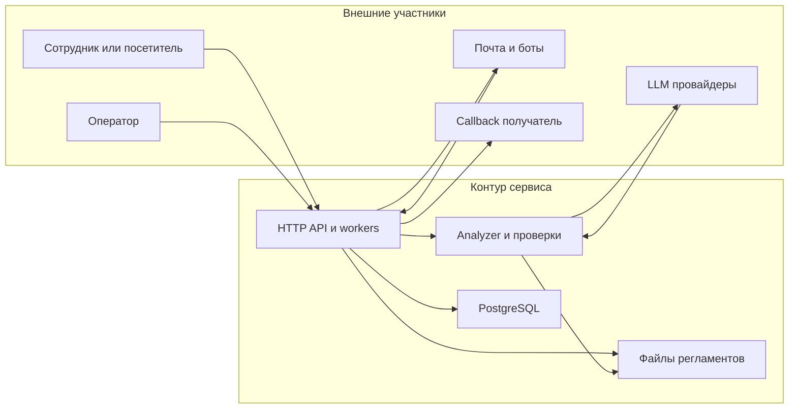

## Executive summary

FlowOps AI принимает обращения сотрудников, хранит исходный текст в PostgreSQL, классифицирует через внешний LLM или локальную эвристику, подбирает Markdown-регламент и отправляет ответы через web/почту/боты/callback. Для заявленного использования с финансовыми и персональными данными основные угрозы — чужой доступ к заявкам, подделка подтверждения и отправителя, произвольные исходящие запросы, утечки через провайдеров и небезопасный TLS MAX. **До исправления High-находок запуск с реальными данными не рекомендован.** Основание: `cmd/server/main.go:71–104`, `internal/handlers/tickets.go`, `internal/security/operator.go`, `docker-compose.yml`.

## Scope and assumptions

- Проверены исходники HEAD `c05c271`, HTTP API/UI, analyzer/security/knowledge, background channels, схема БД и Docker-конфигурация. Дата — 23 ноября 2026.
- Пользователь подтвердил финансовые и персональные данные и использование моделей/внешних каналов. Это требования к защите; юридическое разрешение на каждый вид передачи не установлено.
- На уточнение про размещение/VPN/SSO пользователь ответил «без понятия». Поэтому внешний шлюз и проверенная идентичность не считаются существующими контролями. Атакующий должен иметь сетевой доступ к HTTP или к включённому каналу; не предполагается, что все порты уже опубликованы в интернет.
- Возможны обычные сотрудники, посторонние через включённые каналы, скомпрометированный корпоративный узел, атакующий на сетевом пути MAX и захваченная учётная запись оператора. Для разных сценариев явно указаны разные предпосылки.
- Не входят в доказанную область: реальная production-сеть, MTA/SSO, запущенный Linux-образ и PostgreSQL ACL, договоры провайдеров, backup/restore, физическая безопасность, устойчивость живой модели к неизвестным атакам.

Открытые вопросы, меняющие риск: доступность извне и возможность обхода шлюза; кто может видеть HR/финансовые обращения и KB; разрешённые категории данных у каждого провайдера; правила привязки ботов к сотрудникам и группам; требования retention/RPO/RTO и разделения компаний/подразделений. Контекст был уточнён до выпуска этой модели; неизвестные параметры сохранены как неизвестные.

## System model

### Primary components

- **Go HTTP server**: собственный ServeMux, обработчики tickets/knowledge, статический web frontend; таймауты; частичное bearer middleware (`cmd/server/main.go:81–104`).
- **Tickets/DB**: PostgreSQL/pgx, raw_text, адрес отправителя, callback, классификация, статусы, ответы и audit_logs (`internal/database/db.go:35–100`, `internal/models/ticket.go:5–37`).
- **Analyzer**: проверка входа, маскирование regex, GigaChat с fallback, Gemini/совместимый API, строгий JSON и локальная эвристика (`internal/analyzer/analyzer.go:71–153`).
- **Knowledge**: Markdown на writable volume, индекс в памяти, создание/замена/TTL и выбор ответа по ключевым словам/отделу (`internal/knowledge/knowledge.go:46–293`).
- **Channel workers/dispatcher**: Telegram/MAX polling и IMAP/SMTP, общий IngestMessage, фоновые ответы и webhook (`internal/channels/channels.go:67–88`, `internal/handlers/tickets.go:90–114,228–289`).
- **Build/deploy**: Go modules, многостадийный Dockerfile, PostgreSQL/app Compose, плавающий builder tag, CA download, отсутствие USER в runtime (`Dockerfile:1–31`, `docker-compose.yml:1–57`). В репозитории нет проверенной production ingress-конфигурации.

### Data flows and trust boundaries

- Пользователь → HTTP server: JSON заявки/feedback, email, channel/sender/callback. Body caps и JSON decoding есть; идентификация для чтения, создания, feedback и ingest отсутствует. Bearer защищает KB и часть mutations (`tickets.go:37–158`, `security/operator.go:13–38`).
- Оператор → HTTP server: общий bearer, KB, ответы и изменения заявок. Сравнение токена constant-time; индивидуальные роли и объектная авторизация отсутствуют; production HTTPS/SSO неизвестны (`operator.go`, `tickets.go:161–265`).
- HTTP server → PostgreSQL: исходные ПДн/финансовый текст, контакты, callback, статусы и audit. SQL параметры используются; DSN Compose имеет административную роль и отключает DB TLS внутри docker-сети. Минимальная роль не задана (`tickets.go:53–61,104–109`, `database/db.go`, `docker-compose.yml:33`).
- HTTP server → KB volume: документы и временные файлы. Авторизованный вход для API, validation содержания, atomic replacement при обновлении, TTL. Утверждения по аудитории нет; доступ к volume — отдельная граница (`knowledge.go:88–174`, `handlers/knowledge.go`).
- Analyzer → LLM providers: JSON untrusted_ticket с regex-маскированием и без KB; TLS по умолчанию для GigaChat, запрет redirects, caps, timeout, no tools. Маскирование неполно, политика передачи/допустимого fallback отсутствует (`analyzer.go:85–125,224–249`, `guard.go:18–106,138–170`).
- Внешние Telegram/MAX/IMAP → workers → IngestMessage: текст и внешний идентификатор. Worker токен аутентифицирует связь с платформой, но не сотрудника компании. MAX defaults отключают сертификатную проверку; почтовый From не является проверенной корпоративной личностью (`channels.go:53–64`, `email.go:146–166`, `telegram.go:100–124`, `max.go:129–159`).
- Dispatcher/server → внешние каналы/callback: ответ оператора и ID. Нет надёжного outbox; callback не ограничен сетью/allowlist и следует redirects; MAX TLS небезопасен; SMTP после подключения не имеет deadline (`tickets.go:241–284`, `email.go:273–324`).
- Зависимости/образы/CA → build → runtime: доверие поставке и актуальности. go.sum есть; image digest, scanner CI и воспроизводимый production artifact не представлены (`go.mod`, `go.sum`, `Dockerfile`).

#### Diagram

## Assets and security objectives

| Asset | Why it matters | Security objective (C/I/A) |
|---|---|---|
| Исходные заявки, зарплата/счета/ПДн | Раскрытие чужих данных, вред сотрудникам и компании | C, I |
| Ответы и адреса доставки | Ответ должен получить правильный сотрудник | C, I, A |
| Статусы и подтверждение | Целостность процесса обслуживания и отчётности | I, A |
| Регламенты и аудитория публикации | Внутренние инструкции и правильность советов | C, I, A |
| Токены оператора, ботов, LLM и БД | Доступ к защищённым операциям и внешним учётным записям | C, I |
| Вычисления, LLM бюджет, DB/disk, очереди | Доступность при flood и отказах зависимостей | A |
| Audit trail | Разбор действий и инцидентов | I, A, ограниченная C |
| Сборка и контейнер | Перенос известных уязвимостей/опасных default в production | C, I, A |

## Attacker model

### Capabilities

Человек с сетевым доступом может отправлять HTTP без токена, читать незакрытые endpoints, задавать все поля public ingest, создавать правдоподобные обращения и подавать feedback по ID. Если боты/почта принимают посторонних, возможен текстовый вход через них. Владелец внешнего callback может возвращать redirects. Сетевой атакующий MAX может предъявить свой сертификат из-за insecure default. Оператор или похититель общего токена может выполнять все привилегированные операции и reset.

### Non-capabilities

Не предполагаются знание случайного токена, прямой shell/доступ к .env/диску/БД, контроль доверенного корпоративного шлюза или перехват нормально проверяемого HTTPS. LLM не имеет tools и KB в своём запросе. В SSRF-сценарии нужен операторский ответ, и доказан POST с заданным JSON, а не произвольный протокол, чтение любого ответа или RCE. Прямой доступ к PostgreSQL извне не доказан: Compose публикует loopback.

## Entry points and attack surfaces

| Surface | How reached | Trust boundary | Notes | Evidence (repo path / symbol) |
|---|---|---|---|---|
| GET tickets, detail | HTTP и employee/operator UI | посетитель → чужие объекты | Без owner/role filter; полный исходный текст | `cmd/server/main.go:82–83`; `tickets.go:434,472` |
| POST tickets | HTTP | ввод → analyzer/DB | Email задаёт клиент; до 1 MiB; без identity | `tickets.go:37–71` |
| POST ingest | HTTP интеграция | клиент → доверенный канал/адрес | Sender/channel/callback подставляются | `tickets.go:74–114` |
| POST feedback | HTTP | клиент → состояние объекта | Нет owner и проверки предыдущего состояния | `tickets.go:133–158` |
| PATCH/POST reply/DELETE reset | bearer HTTP | оператор → все заявки/каналы | Общий токен, reset разрушителен | `operator.go:17–38`; `tickets.go:161–300` |
| GET stats/audit | HTTP | посетитель → операционные данные | Не требуют токена | `main.go:90–91`; `tickets.go:306,373` |
| KB list/create/update/delete | bearer HTTP | оператор → KB файлы/ответы | Validation не определяет права аудитории | `handlers/knowledge.go`; `knowledge.go:248` |
| Telegram/MAX polling | Платформы ботов | внешний пользователь → очередь | Нет корпоративной привязки/allowlist; MAX TLS | `telegram.go:70`; `max.go:78`; `channels.go:53` |
| IMAP/MIME/SMTP | Почтовый ящик | почта → identity/DB/внешний адрес | From, ресурсы парсинга и deadlines | `email.go:49,113,226,273` |
| LLM responses | Внешний API | модель → metadata | Строгий JSON, size cap, no tools | `guard.go:43–106,138–149` |
| Callback | Ответ оператора | app network → произвольный host | Нет URL/IP allowlist; redirects | `tickets.go:268–284` |
| Static UI | HTTP браузер | данные → HTML | Основные тексты escaped; headers edge неизвестны | `web/app.js:47–126`; `main.go:193` |
| Modules/images/CA/files | Build и deployment | поставка → runtime | Не смешивать с анонимным HTTP input | `Dockerfile`; `go.mod`; `knowledge.go:46` |

## Top abuse paths

1. **Прочитать данные коллег:** получить сетевой доступ → GET tickets без токена → забрать raw_text/email/operator_reply всех сотрудников. UI-фильтр не препятствует прямому запросу. SEC-001.
2. **Подделать решение:** получить ID → POST feedback resolved=true → скрыть нерешённую заявку за auto_resolved; false позволяет вмешаться в закрытый процесс. SEC-002.
3. **Использовать внутреннюю сеть:** public ingest с callback → оператор отвечает → сервер делает POST во внутренний адрес, включая через 307. SEC-003.
4. **Похитить токен MAX:** контроль сетевого пути → недоверенный сертификат принимается → токен/сообщения уходят ложному endpoint. SEC-004.
5. **Вывести чувствительные сведения:** обычное обращение с немаскируемым ФИО/счётом/uppercase email → regex пропускает → разрешённый ключ активирует внешний provider или fallback. Аналогичный пропуск допускает чувствительный KB-ответ. SEC-005.
6. **Подделать сотрудника/адрес ответа:** задать sender/channel через HTTP либо неподтверждённый внешний канал → оператор доверяет личности → отправляет ответ не тому получателю. SEC-007.
7. **Вытеснить пользователей/потерять доставку:** flood public create → общий 60/min → ручная очередь/накопление БД; отказ SMTP/бота → closed сохраняется, доставки нет. SEC-009/011/012.
8. **Расширить последствия компрометации:** украденный общий операторский токен → нет индивидуальных ролей → массовый reset; компрометированный процесс использует административный DB DSN. Уязвимые зависимости/непроверенная сборка увеличивают поверхность, но не доказывают конкретный exploit. SEC-006/008/010.

## Threat model table

| Threat ID | Threat source | Prerequisites | Threat action | Impact | Impacted assets | Existing controls (evidence) | Gaps | Recommended mitigations | Detection ideas | Likelihood | Impact severity | Priority |
|---|---|---|---|---|---|---|---|---|---|---|---|---|
| TM-001 | Посетитель/сотрудник | Доступ к HTTP | Чтение чужих tickets/detail/audit | Раскрытие ПДн/финансовых обращений | Заявки, ответы | SQL parameters; `tickets.go:478` | Нет identity/owner; SEC-001 | Вход, role/owner predicates, минимизация полей | Субъект/объект и аномалии чтения без содержимого | high: один запрос | high: вся очередь | high |
| TM-002 | Посетитель/сотрудник | ID заявки | Подделка feedback | Нарушение состояния и метрик | Статусы | JSON/body validation; `tickets.go:140` | Нет владельца/state guard; SEC-002 | Owner+state machine+CAS/transaction | Аномальные переходы/чужие объекты | high: ID доступны | high: рабочий процесс | high |
| TM-003 | Автор заявки | Доступ к ingest, ответ оператора | Callback на private host/redirect | Серверный POST, утечка ответа | Внутренняя сеть, ответы | Timeout 3s; `tickets.go:269` | Нет allowlist/redirect denial; SEC-003 | Зарегистрированные endpoint, DNS/IP-safe dial, egress filter | Allowlist violations, очередь/доставки | medium: нужен оператор | high: trust boundary | high |
| TM-004 | Сетевой атакующий | MAX включён, сетевой контроль | Поддельный TLS peer | Кража токена и подмена сообщений | Токен/заявки | Timeout; `channels.go:62` | Insecure default; SEC-004 | Обязательный TLS verification, CA policy | Ошибки TLS, изменение endpoint/config | medium: нужна позиция | high: канал скомпрометирован | high |
| TM-005 | Пользователь/оператор/ошибка config | Ключ внешней модели или чувствительная KB | Передача немаскированных данных | Выход за согласованную аудиторию/контур | ПДн, финансы, регламенты | Regex, no KB in LLM, schema; `analyzer.go:88`, `guard.go:18` | Маскирование не универсально, нет provider/audience policy; SEC-005 | Политика данных/провайдеров, fail-closed, публикация KB по правам | Аудит provider decisions, DLP events без raw payload | high: обычные форматы | high: чувствительные данные | high |
| TM-006 | Клиент ingest/внешнего канала | Доступ к каналу | Sender spoof и неверный адрес доставки | Имперсонация/раскрытие ответа | Identity, ответы | ParseAddress / chat parsing; `dispatcher.go:18` | Нет связи с сотрудником; SEC-007 | Подписанный ingest, directory binding, ограничения групп | Несвязанные sender, replay/подписи | high: JSON произволен | high: доверие сотруднику | high |
| TM-007 | Flood/недоступная зависимость | Доступ к create/каналу | Исчерпать бюджет/DB; удержать SMTP; потерять reply | Падение качества/недоставка | Compute, очередь, диск | HTTP/body/AI timeouts; `main.go:101`; `guard.go:154` | Нет per-identity ingress, list paging/outbox/session deadline; SEC-009/011/012 | Квоты, backpressure, outbox, deadlines/worker pool | Размер DB/очереди, доля manual, delivery age | high: вход прост | medium: измерение масштаба не проведено | medium |
| TM-008 | Укравший токен/компрометированный runtime | Уже получен секрет или выполнение в app | Reset/изменение всех отделов и DB | Широкий ущерб, слабая атрибуция | Данные, KB, аудит | Constant-time token check; `operator.go:34` | Shared privilege/admin DB; SEC-008/010 | Роли/отзыв, migration split, audit reliability, backups | Массовые операции, субъект и request ID | low: секрет не угадывается | high: весь сервис | high |
| TM-009 | Уязвимая поставка/ошибка сопровождения | Сборка старым Go/модулями | Использование известного дефекта при подходящих условиях | DoS/иные последствия конкретного advisory | Runtime C/I/A | go.sum; body/time limits | Scanner findings; floating image; SEC-006 | Обновление, CI scanner, final binary/image validation | Dependency findings и нарушенный baseline | medium: зависит от advisory | high: runtime/network parsers | high |

## Criticality calibration

- **critical:** доказанное выполнение кода до входа с полным доступом к инфраструктуре; доказанная прямая финансовая операция от имени компании. Таких результатов в этом аудите нет; сервис не содержит механизма банковского перевода.
- **high:** чтение чужих финансовых/персональных обращений; подделка подтверждения решения; серверный callback во внутреннюю сеть после действия оператора. При ограниченном размещении меняется круг атакующих, но сама граница доступа остаётся нарушенной.
- **medium:** исчерпание общей классификации с ручной деградацией; недоставленный ответ при уже закрытой заявке; зависший SMTP-сеанс при ещё работоспособном web-канале. При доказанном полном отказе критичного процесса severity следует пересмотреть.
- **low:** ограниченное раскрытие технологического имени модели без бизнес-данных; неудобный, но не нарушающий права UI-сценарий; недостаток заголовка при отсутствии доказанного пути эксплуатации и наличии иных контролей. Не путать с открытым чтением заявок.

## Focus paths for security review

| Path | Why it matters | Related Threat IDs |
|---|---|---|
| `cmd/server/main.go` | Все маршруты, bind/defaults и граница middleware | TM-001, TM-002, TM-004 |
| `internal/security/operator.go` | Неполный auth coverage, общий секрет | TM-001, TM-002, TM-008 |
| `internal/handlers/tickets.go` | SQL ownership/state, ingest, callback, доставка | TM-001, TM-002, TM-003, TM-006, TM-007 |
| `internal/analyzer/analyzer.go` | Provider choice/fallback, маскированный payload | TM-005, TM-007 |
| `internal/analyzer/guard.go` | Ограничение модели, бюджет и фильтр KB | TM-005, TM-007 |
| `internal/security/pii.go` | Конкретные пропуски обезличивания | TM-005 |
| `internal/knowledge/knowledge.go` | Retrieval без audience ACL, файлы/TTL | TM-005, TM-008 |
| `internal/channels/channels.go` | MAX TLS и запуск внешних workers | TM-004, TM-006 |
| `internal/channels/dispatcher.go` | Использование sender как адреса доставки | TM-006, TM-007 |
| `internal/channels/email.go` | From, MIME/IMAP/SMTP, timeouts | TM-006, TM-007 |
| `internal/channels/telegram.go`, `max.go` | Связь внешних аккаунтов с компанией | TM-004, TM-006 |
| `internal/database/db.go` | Runtime DDL и права DB | TM-008 |
| `web/app.js` | Клиентская фильтрация всех заявок и токен | TM-001, TM-008 |
| `Dockerfile`, `docker-compose.yml`, `go.mod` | Сборка, опасные defaults, advisories | TM-004, TM-008, TM-009 |

## Notes on use

Подробные исправления, локальные доказательства и ограничения — в `security_best_practices_report.md`; последний diff — в `DIFFERENTIAL_REVIEW_REPORT.md`. Наличие структурированной модели не заменяет тесты и аудит реального развёртывания. Возможности LLM ограничены архитектурой, но это не исправляет неавторизованный HTTP-доступ.

Проверка полноты:

- [x] Перечислены все найденные бизнес-маршруты, workers, LLM/callback, static и build entrypoints.
- [x] Каждая граница доверия связана с угрозой; runtime и build разделены.
- [x] Учтён ответ пользователя о данных и неизвестности SSO/deployment.
- [x] Существующие контроли отделены от рекомендованных; условия SSRF/MITM/компрометации явны.
- [x] Непроверенные инфраструктурные и эксплуатационные условия сохранены как открытые вопросы.
